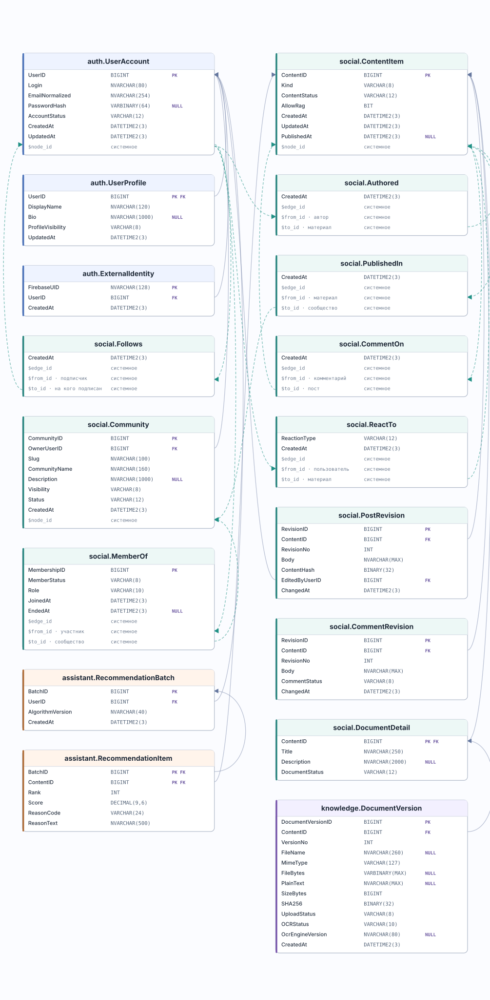

# Схемы данных SocialNetworkDB

Обе схемы построены по T-SQL для SQL Server 2025. Внутри каждой таблица показана один раз, со всеми объявленными полями и точными типами. Приглушённые поля с `$` добавлены SQL Server для `AS NODE` и `AS EDGE`; это не объявленные нами столбцы.

## 1. Полная модель

**33 таблицы, 197 полей, 32 внешних ключа и 9 связей SQL Graph.** Включены данные соцсети, RAG, граф знаний, индексация и служебные записи. [Открыть SVG](database-model.svg); кнопка **Raw** в GitHub показывает его в полном размере.

## 2. Продуктовые данные социальной сети

**17 таблиц, 84 поля, 11 внешних ключей и 6 связей SQL Graph.** Пользователи, сообщества, подписки, публикации, комментарии, реакции, документы и рекомендательная лента. Таблицы RAG и индексации исключены. `knowledge.DocumentVersion` включена, потому что в ней хранится загруженный пользователем документ. [Открыть SVG](product-model.svg).

**Как читать:** `PK` — первичный ключ, `FK` — внешний ключ, `NULL` — поле допускает пустое значение. Сплошная стрелка ведёт от поля `FK` к полю, на которое оно ссылается. Пунктирные стрелки показывают SQL Graph: `узел.$node_id → ребро.$from_id` и `ребро.$to_id → узел.$node_id`. Подписи у концов ребра показывают роли, например «подписчик» и «на кого подписан».

| SQL Graph | Что важно знать |
| --- | --- |
| Узел `AS NODE` | `$node_id` обозначает строку узла внутри SQL Graph; обычный `UserID` или `ContentID` остаётся ключом приложения. |
| Ребро `AS EDGE` | SQL Server добавляет `$edge_id`, `$from_id`, `$to_id`. При `INSERT` мы **явно передаём** в `$from_id` и `$to_id` значения `$node_id` выбранных узлов; связь сама не возникает. |
| `CONNECTION` | Ограничивает допустимые таблицы концов ребра и проверяет их существование. Это ограничение SQL Graph, не обычный `FOREIGN KEY`. |
| `knowledge.ChunkOf` | Связывает `Chunk → ContentItem`; объявленных полей нет, на схеме показаны только три системных поля ребра. |

Для `Follows` направление означает **подписчик → пользователь, на которого подписались**. Для `MemberOf` — **участник → сообщество**. Системные поля не входят в указанные выше числа объявленных столбцов. Источник обеих схем — [T-SQL DDL](../database/README.md). После изменения DDL обновите SVG командой `python3 tools/generate_database_model_svg.py` из корня курсовой.
