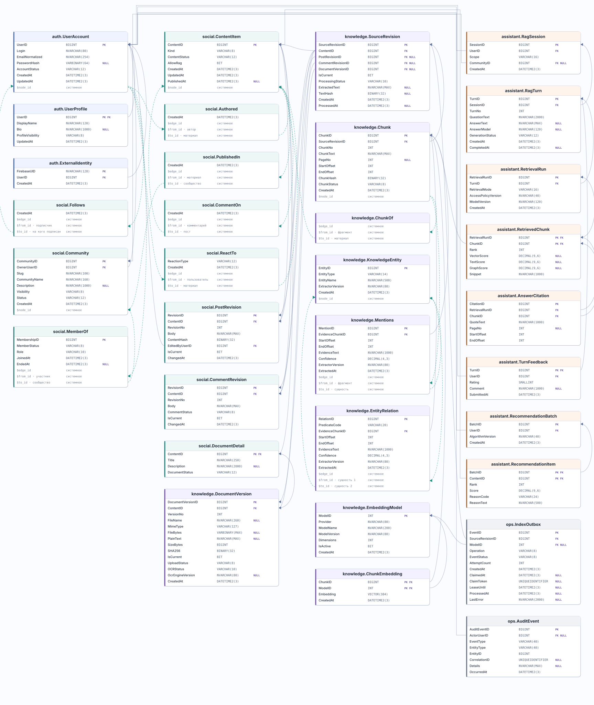

# Все таблицы SocialNetworkDB

Одна база SQL Server 2025: **33 таблицы, 197 объявленных полей, 32 внешних ключа и 9 связей SQL Graph**. Каждая таблица показана **один раз**. Внутри — все объявленные в T-SQL поля и их типы. Полную схему можно [открыть как SVG и увеличить](database-model.svg).

**Как читать:** `PK` — первичный ключ, `FK` — внешний ключ, `NULL` — поле допускает пустое значение. Сплошная стрелка ведёт от поля `FK` к полю, на которое оно ссылается; пунктирная проходит через таблицу ребра SQL Graph. Четыре составных внешних ключа показаны линиями для каждой пары полей. Цвет заголовка помогает отличать схемы `auth`, `social`, `knowledge`, `assistant`, `ops`.

| SQL Graph | Системные поля, создаваемые SQL Server |
| --- | --- |
| Узел `AS NODE` | `$node_id` |
| Ребро `AS EDGE` | `$edge_id`, `$from_id`, `$to_id` |

Эти системные поля не перечислены внутри блоков, потому что их нет среди объявленных столбцов `CREATE TABLE`. Источник схемы — [T-SQL DDL](../database/README.md). После изменения DDL SVG обновляется командой `python3 tools/generate_database_model_svg.py` из корня курсовой.
