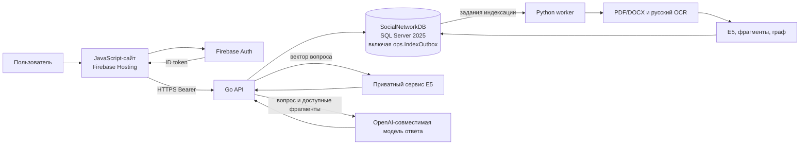
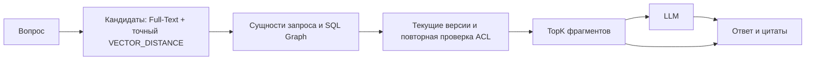

# Архитектура курсовой

Тема: «Информационная поддержка работы социальной сети». Согласованные решения
зафиксированы в [разделе 11 документа в Google Drive](https://docs.google.com/document/d/187AqSxvD9fiTLw3ExvQa6wspBZPqk7LPda7mL57pLCg/edit?usp=drivesdk).
Предыдущие разделы документа описывают обсуждение; при расхождении действует
раздел 11. Таблицы и ключевые связи перечислены в [модели данных](data-model.md).

## Границы системы

В единственной базе `SocialNetworkDB` находятся схемы `auth`, `social`,
`knowledge`, `assistant`, `ops`. SQL Server хранит оригиналы PDF/DOCX как
`VARBINARY(MAX)`, редакции и фрагменты текста, embeddings как `VECTOR(384)`,
социальные связи и извлечённые знания в SQL Graph, историю ответов и рекомендации.
Go backend реализует авторизованные социальные маршруты, чтение материалов и
RAG-оркестрацию; Python worker содержит извлечение текста, русский OCR,
embeddings и простое правило извлечения сущностей с привязкой к фрагментам.
Отдельный приватный сервис в `worker/` строит embedding вопроса. Код находится
в [`backend/`](../backend/) и [`worker/`](../worker/); сквозной запуск требует
настройки Firebase, SQL Server, ODBC и моделей.
HTTP-интерфейс описан в [контракте API](../api/openapi.yaml).
SQL Graph служит источником связей для
поиска и ранжирования; сам ответ формирует LLM.

Для русского и смешанного текста выбрана модель
[`intfloat/multilingual-e5-small` на фиксированной ревизии](https://huggingface.co/intfloat/multilingual-e5-small/tree/fd1525a9fd15316a2d503bf26ab031a61d056e98)
с размерностью 384. При создании вектора запроса применяется префикс `query:`,
при индексировании фрагмента — `passage:`. В первой версии используется точный
`VECTOR_DISTANCE`, без приближённого векторного индекса.

## Загрузка и обновление материала

1. Приложение проверяет право на публикацию и сохраняет пост, комментарий или
   версию документа. Для PDF/DOCX сохраняются файл, MIME-тип, размер и SHA-256.
2. Новая `knowledge.SourceRevision` ссылается ровно на одну исходную редакцию.
   Триггер добавляет событие в `ops.IndexOutbox` в той же короткой транзакции.
3. Фоновый обработчик извлекает текст из DOCX/текстового PDF; сканированный PDF
   распознаёт на русском. Он нарезает текст на фрагменты с номером страницы и
   координатами, создаёт embeddings и SQL Graph-связи с исходным фрагментом,
   уверенностью и версией извлекателя.
4. Worker получает `ClaimToken`, продлевает аренду и записывает фрагменты,
   векторы и рёбра через `ops.usp_CommitIndexResult` в одной транзакции.
   Устаревший токен не может завершить запись. После трёх неудач источник
   получает `FAILED`; оператор может повторить задание после исправления причины.

Поиск использует только текущие опубликованные редакции и видимые комментарии.
После новой редакции прежняя остаётся в истории, но исключается из новых
ответов. Скрытие и удаление закрывают материал, а `AllowRag = 0` отключает его
для RAG синхронно в SQL;
очистка производных векторов и рёбер выполняется через outbox. Старое ребро
не может вернуть отозванный материал в ответ.

## Проверка доступа

| Объект | Условие чтения |
| --- | --- |
| Открытое сообщество | Активная учётная запись и видимый опубликованный материал; действующая блокировка в этом сообществе запрещает чтение. |
| Закрытое сообщество | Владелец или активное членство `social.MemberOf`; заявки, отклонённое и заблокированное членство не подходят. |
| Комментарий | Права на родительский пост, видимый статус комментария и текущая редакция. |
| Фрагмент и графовое свидетельство | Доступный источник, текущая редакция, разрешение `AllowRag` и готовый фрагмент. |

Публиковать посты, комментарии и документы может владелец сообщества или
активный участник; чтение открытого сообщества само по себе не даёт право
публикации. Это проверяет `auth.fn_UserCanWriteCommunity` до и внутри
транзакции записи.

Единое правило чтения задаёт `auth.fn_UserCanReadCommunity`;
`social.vAccessibleContent` связывает его с материалами, а
`knowledge.vCurrentRagChunks` выбирает актуальные фрагменты. Поиск соединяет
оба представления до ранжирования. Права проверяются повторно после текстового/векторного поиска, после
графового расширения, при фиксации набора для LLM и перед показом цитат.
SQL-проверка и внешний HTTP-вызов модели не составляют одну транзакцию:
если доступ отозван в этом промежутке, последующая проверка запрещает
сохранить или выдать ответ, но уже переданный модели контекст отозвать нельзя.
Подписка на пользователя влияет на рекомендации, но не открывает закрытое
сообщество. Содержимое источников считается данными, а не инструкциями для LLM.

Параметр `@UserID` Go API получает только после проверки Firebase ID token
через Admin SDK и вызова `auth.usp_GetOrCreateFirebaseUser`. Клиентский `UserID`
для SQL не принимается. Учётные записи API и worker добавляются DBA в отдельные
роли `coursework_api` и `coursework_worker`, у которых есть право `EXECUTE`
только на нужные процедуры и нет прямого доступа к таблицам. Полная сквозная
изоляция требует интеграционной проверки с настоящими SQL-логинами и Firebase.

## RAG с проверяемыми цитатами

По умолчанию вопрос ищет во **всех доступных** сообществах; параметр
`@CommunityID` может ограничить поиск одним доступным сообществом. SQL Full-Text Search
и точное расстояние между векторами дают кандидатов. Go извлекает из вопроса
словосочетания длиной от одного до трёх слов и сопоставляет их с именами
сущностей в SQL Graph для переранжирования. Это простой лексический приём,
а не полноценное распознавание сущностей в вопросе. Рёбра знаний используются
только вместе с доступным `EvidenceChunkID`. После ранжирования backend
вызывает `assistant.usp_RecordRetrievedChunks` и передаёт LLM только повторно
проверенные фрагменты. Сессию и ход создают `assistant.usp_StartRagSession` и
`assistant.usp_StartRagTurn`. `assistant.RetrievalRun` хранит
параметры выборки, `assistant.RetrievedChunk` — реально переданные фрагменты и
оценки, `assistant.AnswerCitation` — цитаты, привязанные к этим фрагментам.
Завершённый ответ требует хотя бы одну проверенную цитату. Пустую выдачу
`assistant.usp_SaveRagNoSources` записывает со статусом `NO_SOURCES`, не вызывая
LLM. `assistant.usp_GetRagTurn` повторно проверяет все использованные источники
и не выдаёт сохранённый ответ после отзыва доступа. Ответ показывает автора,
тип источника, выдержку и страницу документа,
если она известна.

HTTP `POST /v1/rag/queries` проверяет доступность моделей до создания SQL-хода,
затем выполняет поиск и генерацию. Ответ LLM должен содержать ссылки `[n]` на
номера переданных фрагментов; Go проверяет номера и сохраняет только
упомянутые цитаты. После повторной проверки ACL в SQL маршрут возвращает
`201` и ID хода в состоянии `COMPLETED` или `NO_SOURCES`. Если модель не
настроена или предварительная проверка не прошла, возвращается `503` без
создания хода. Сбой генерации после начала поиска тоже возвращает `503`;
backend пытается отметить созданный ход как `FAILED`. `GET` применяет SQL ACL к
сохранённому результату.
Генерация пока выполняется внутри HTTP-запроса до 90 секунд; после обрыва
процесса незавершённый ход может остаться `PENDING` до ручного восстановления.

## Рекомендательная лента

Кандидаты — доступные опубликованные посты и актуальные документы. Комментарии
служат сигналом интереса, но сами в ленту не попадают. Начальная формула для
признаков в диапазоне 0..1:

`score = 0.30 × тема/сущности + 0.25 × подписка на автора + 0.20 × активное членство + 0.15 × реакции/комментарии + 0.10 × свежесть`.

Это правило, а не обученная модель; коэффициенты заданы в
`assistant.usp_GenerateRecommendations`. Лента
исключает собственные, скрытые и удалённые публикации, ограничивает повторы
авторов и сообществ. При отсутствии истории показывает свежие и популярные
доступные материалы. `assistant.RecommendationItem` сохраняет оценку и главную
причину из сильнейших сигналов. Причина не должна раскрывать недоступный
материал или закрытое сообщество.

## Размещение

Сайт из [`web/`](../web/) можно разместить на [Firebase Hosting](https://firebase.google.com/docs/hosting/quickstart).
Go API и SQL Server должны работать в среде с сетевым доступом к SQL Server;
worker запускается отдельным процессом. [Cloud Run с оплатой за запрос](https://docs.cloud.google.com/run/docs/configuring/billing-settings)
не подходит для постоянного опроса outbox внутри API. Firebase Hosting rewrite
к Cloud Run требует плана Blaze и ограничен 60 секундами на запрос; текущий
синхронный RAG-маршрут может работать дольше. Для размещения используйте
отдельный адрес API с таймаутом больше 90 секунд либо добавьте долговечную
очередь генерации перед использованием rewrite.

SQL Server 2025 Express бесплатен как движок, но постоянное облачное размещение
SQL Server не является бесплатным: [Cloud SQL тарифицирует вычисления и хранение](https://cloud.google.com/sql/pricing/).
Для демонстрации предусмотрен локальный SQL Server 2025; публичное размещение
требует отдельной сметы и настройки, код сайта сам по себе не развёрнут.
