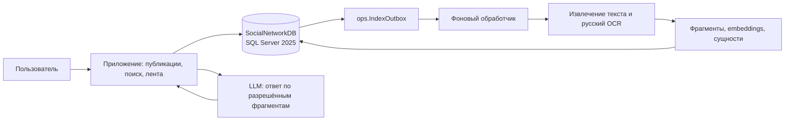
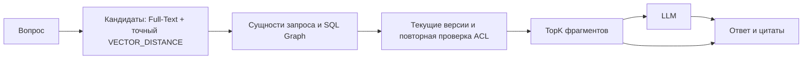

# Архитектура курсовой

Тема: «Информационная поддержка работы социальной сети». Согласованные решения
зафиксированы в [разделе 11 документа в Google Drive](https://docs.google.com/document/d/187AqSxvD9fiTLw3ExvQa6wspBZPqk7LPda7mL57pLCg/edit?usp=drivesdk).
Предыдущие разделы документа описывают обсуждение; при расхождении действует
раздел 11. Таблицы и ключевые связи перечислены в [модели данных](data-model.md).

## Границы системы

В единственной базе `SocialNetworkDB` находятся схемы `auth`, `social`,
`knowledge`, `assistant`, `ops`. SQL Server хранит оригиналы PDF/DOCX как
`VARBINARY(MAX)`, редакции и фрагменты текста, embeddings как `VECTOR(384)`,
социальные связи и извлечённые знания в SQL Graph, историю ответов и рекомендации.
OCR, вычисление embeddings, извлечение сущностей и генерация текста выполняются
в приложении или фоновом обработчике. SQL Graph служит источником связей для
поиска и ранжирования; сам ответ формирует LLM.

Для русского и смешанного текста выбрана модель
[`intfloat/multilingual-e5-small`](https://huggingface.co/intfloat/multilingual-e5-small)
с размерностью 384. При создании вектора запроса применяется префикс `query:`,
при индексировании фрагмента — `passage:`. В первой версии используется точный
`VECTOR_DISTANCE`, без приближённого векторного индекса.

## Загрузка и обновление материала

1. Приложение проверяет право на публикацию и сохраняет пост, комментарий или
   версию документа. Для PDF/DOCX сохраняются файл, MIME-тип, размер и SHA-256.
2. Новая `knowledge.SourceRevision` ссылается ровно на одну исходную редакцию.
   Триггер добавляет событие в `ops.IndexOutbox` в той же короткой транзакции.
3. Фоновый обработчик извлекает текст из DOCX/текстового PDF; сканированный PDF
   распознаёт на русском. Он нарезает текст на фрагменты с номером страницы и
   координатами, создаёт embeddings и SQL Graph-связи с исходным фрагментом,
   уверенностью и версией извлекателя.
4. Повторная обработка не должна дублировать фрагменты или embeddings. Ошибка
   разбора оставляет оригинал доступным для повторной попытки, но не создаёт
   поисковые результаты из неготовых фрагментов.

Поиск использует только текущие опубликованные редакции и видимые комментарии.
После новой редакции прежняя остаётся в истории, но исключается из новых
ответов. Скрытие и удаление закрывают материал, а `AllowRag = 0` отключает его
для RAG синхронно в SQL;
очистка производных векторов и рёбер выполняется через outbox. Старое ребро
не может вернуть отозванный материал в ответ.

## Проверка доступа

| Объект | Условие чтения |
| --- | --- |
| Открытое сообщество | Активная учётная запись и видимый опубликованный материал. |
| Закрытое сообщество | Владелец или активное членство `social.MemberOf`; заявки, отклонённое и заблокированное членство не подходят. |
| Комментарий | Права на родительский пост, видимый статус комментария и текущая редакция. |
| Фрагмент и графовое свидетельство | Доступный источник, текущая редакция, разрешение `AllowRag` и готовый фрагмент. |

Единое правило доступа задаёт `auth.fn_UserCanReadCommunity`;
`social.vAccessibleContent` связывает его с материалами, а
`knowledge.vCurrentRagChunks` выбирает актуальные фрагменты. Поиск соединяет
оба представления до ранжирования. Права проверяются повторно после текстового/векторного поиска, после
графового расширения и ещё раз перед передачей контекста LLM и показом цитат.
Подписка на пользователя влияет на рекомендации, но не открывает закрытое
сообщество. Содержимое источников считается данными, а не инструкциями для LLM.

## RAG с проверяемыми цитатами

По умолчанию вопрос ищет во **всех доступных** сообществах. SQL Full-Text Search
и точное расстояние между векторами дают кандидатов; извлечённые из запроса
сущности и SQL Graph помогают переранжировать их. Рёбра знаний используются
только вместе с доступным `EvidenceChunkID`. После удаления дублей приложение
передаёт LLM только разрешённые фрагменты. `assistant.RetrievalRun` хранит
параметры выборки, `assistant.RetrievedChunk` — реально переданные фрагменты и
оценки, `assistant.AnswerCitation` — цитаты, привязанные к этим фрагментам.
Ответ показывает автора, тип источника, выдержку и страницу документа, если
она известна. При недостатке свидетельств он сообщает об этом без догадок.

## Рекомендательная лента

Кандидаты — доступные опубликованные посты и актуальные документы. Комментарии
служат сигналом интереса, но сами в ленту не попадают. Начальная формула для
признаков в диапазоне 0..1:

`score = 0.30 × тема/сущности + 0.25 × подписка на автора + 0.20 × активное членство + 0.15 × реакции/комментарии + 0.10 × свежесть`.

Это правило, а не обученная модель; коэффициенты конфигурируются. Лента
исключает собственные, скрытые и удалённые публикации, ограничивает повторы
авторов и сообществ. При отсутствии истории показывает свежие и популярные
доступные материалы. `assistant.RecommendationItem` сохраняет оценку и главную
причину из сильнейших сигналов. Причина не должна раскрывать недоступный
материал или закрытое сообщество.
