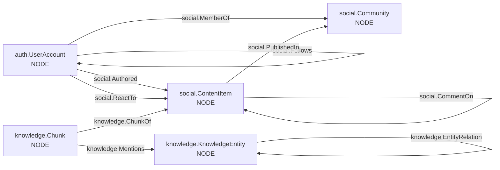
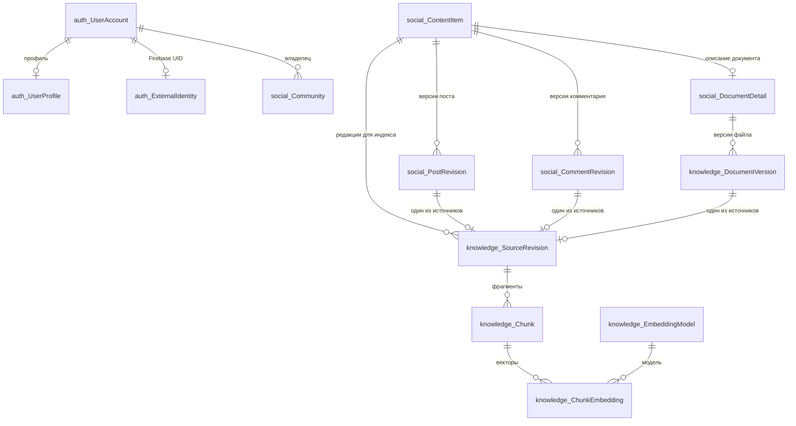
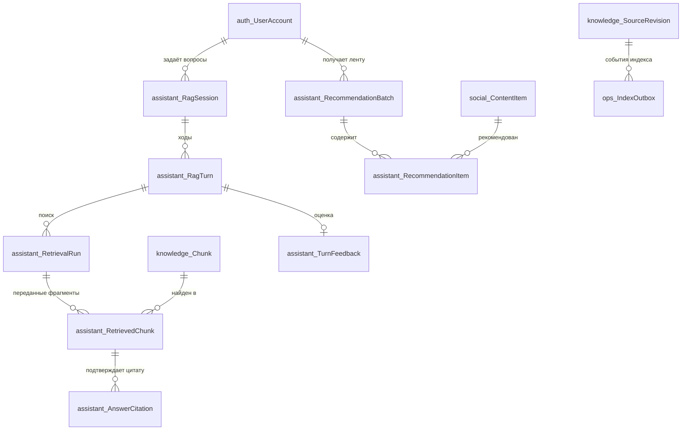

# Модель данных и ER-связи

Источник проектных решений — [раздел 11 документа в Google Drive](https://docs.google.com/document/d/187AqSxvD9fiTLw3ExvQa6wspBZPqk7LPda7mL57pLCg/edit?usp=drivesdk).
Все объекты находятся в **одной** базе `SocialNetworkDB` на SQL Server 2025.
Префикс до точки обозначает схему SQL, а не отдельную базу. Архитектурные
потоки и правило доступа описаны в [architecture.md](architecture.md).

## Каталог таблиц

| Схема | Узлы SQL Graph (`AS NODE`) | Рёбра SQL Graph (`AS EDGE`) | Обычные таблицы |
| --- | --- | --- | --- |
| `auth` | `UserAccount` | — | `UserProfile`, `ExternalIdentity` |
| `social` | `Community`, `ContentItem` | `Follows`, `MemberOf`, `Authored`, `PublishedIn`, `CommentOn`, `ReactTo` | `PostRevision`, `CommentRevision`, `DocumentDetail` |
| `knowledge` | `Chunk`, `KnowledgeEntity` | `ChunkOf`, `Mentions`, `EntityRelation` | `DocumentVersion`, `SourceRevision`, `EmbeddingModel`, `ChunkEmbedding` |
| `assistant` | — | — | `RagSession`, `RagTurn`, `RetrievalRun`, `RetrievedChunk`, `AnswerCitation`, `TurnFeedback`, `RecommendationBatch`, `RecommendationItem` |
| `ops` | — | — | `IndexOutbox`, `AuditEvent` |

Итого: **5 узлов, 9 рёбер и 19 обычных таблиц — 33 таблицы**. Это физические
таблицы; представления, функции, процедуры и триггеры в счёт не входят.

## Социальный граф и граф знаний

Направления стрелок соответствуют `$from_id` → `$to_id`. `ContentItem.Kind`
различает `Post`, `Comment`, `Document`. Для `CommentOn` начало — только
комментарий, конец — только пост; `ReactTo` направлено на пост или комментарий.
Это правила процедур записи: ограничение SQL Graph `CONNECTION` проверяет
таблицы концов, но не значение `ContentItem.Kind`.
В `MemberOf` хранятся роль, статус и даты; доступ к закрытому сообществу
предоставляет только `ACTIVE` с пустым `EndedAt`. Действующий `BLOCKED` или `BANNED`
закрывает чтение даже открытого сообщества. `KnowledgeEntity` — отдельное извлечённое
упоминание темы, человека, организации, события или места. Узлы с похожими
названиями автоматически не объединяются.

У `Mentions` исходный `Chunk` задаёт источник. У `EntityRelation` обязателен
`EvidenceChunkID`: каждое ребро — отдельное свидетельство с предикатом
`PARTICIPATES_IN`, `WORKS_AT`, `TAKES_PLACE_IN` или `RELATED_TO`.
Для извлечённых рёбер сохраняются координаты внутри извлечённого текста, `Confidence`
в диапазоне 0..1 и `ExtractorVersion`. Для ответа и ранжирования ребро
пригодно только тогда, когда его исходный фрагмент доступен пользователю.

## ER: версии и поисковые фрагменты

В Mermaid ниже `schema_Table` означает SQL-таблицу `schema.Table`. Диаграмма
показывает внешние ключи; направление связей графа показано отдельно выше.

У `SourceRevision` три необязательных FK на редакции, но `CHECK` требует
**ровно один** непустой FK. Диаграмма ER не выражает это взаимоисключение.
`SourceRevision.IsCurrent`, статусы и `IsCurrent` у редакций исключают
устаревший текст из новых ответов. Для готовых фрагментов действует
уникальность `(SourceRevisionID, ChunkNo)`; цитированные старые фрагменты
могут оставаться со статусом `STALE`. Координаты страницы и символов хранятся
отдельно; связь
`knowledge.ChunkOf` указывает на исходный `ContentItem`.

| Данные | Физический формат | Назначение |
| --- | --- | --- |
| Оригинал PDF/DOCX | `knowledge.DocumentVersion.FileBytes VARBINARY(MAX)` и SHA-256 | Единая транзакция и резервная копия вместе с метаданными; размер загрузки ограничивается приложением. |
| Тексты и фрагменты | `NVARCHAR(MAX)` в редакциях и `knowledge.Chunk`; страница и offsets отдельными столбцами | Поиск и точная цитата из текущей редакции. |
| Embedding фрагмента | `knowledge.ChunkEmbedding.Embedding VECTOR(384)` + FK на `EmbeddingModel` | Модель [`intfloat/multilingual-e5-small` на фиксированной ревизии](https://huggingface.co/intfloat/multilingual-e5-small/tree/fd1525a9fd15316a2d503bf26ab031a61d056e98); текст индексируется с `passage:`, вопрос — с `query:`. |
| Связи | SQL Graph `AS NODE`/`AS EDGE`; доменные ID остаются обычными столбцами | Обход через `MATCH`; автоматически созданные `$node_id`/`$edge_id` не служат публичными ID. |

Для учебного объёма используется точное `VECTOR_DISTANCE`. Новую версию
embedding-модели можно зарегистрировать в `EmbeddingModel`, но операция
массовой переиндексации пока не реализована. До её выполнения нельзя
переключать активную модель или смешивать векторы разных размерностей.
`auth.ExternalIdentity` привязывает проверенный Firebase UID к `UserAccount`;
адрес электронной почты не используется для автоматического объединения
аккаунтов. Роли `coursework_api` и `coursework_worker` получают только права
вызова нужных процедур, без прямого чтения базовых таблиц.

## ER: ответ, рекомендации и обработка

`AnswerCitation` ссылается составным FK на `RetrievedChunk` того же запуска:
ответ не может процитировать фрагмент, который не передавался LLM. Таблица
`ops.AuditEvent` хранит тип действия, время, корреляционный ID и при наличии
актора; пароли, API-ключи и полные документы туда не записываются.

## Программные объекты и инварианты

| Вид | Объекты |
| --- | --- |
| Inline TVF | `auth.fn_UserCanReadCommunity` — правило чтения; `auth.fn_UserCanWriteCommunity` — правило публикации для владельца или активного участника. |
| Представления | `social.vAccessibleContent`, `knowledge.vCurrentRagChunks`, `assistant.vAnswerWithCitations`, `assistant.vRecommendationFeed`. |
| Процедуры | Публикация и документы: `social.usp_PublishContent`, `knowledge.usp_SaveDocumentVersion`, `knowledge.usp_GetDocumentFile`; социальные операции и чтение: процедуры `social.usp_*` из скриптов 12/14/15; RAG: `assistant.usp_StartRagSession`, `usp_StartRagTurn`, `usp_SearchRag`, `usp_RecordRetrievedChunks`, `usp_SaveRagAnswer`, `usp_SaveRagNoSources`, `usp_FailRagTurn`, `usp_GetRagTurn`; также `assistant.usp_GenerateRecommendations`, `assistant.usp_RevokeContentAccess`, `auth.usp_GetOrCreateFirebaseUser` и процедуры `ops` для outbox. |
| Триггер | После добавления `knowledge.SourceRevision` создаёт set-based события `ops.IndexOutbox`; OCR и сетевых вызовов в триггере нет. |

Уникальность логина, подписки и номера редакции, запрет подписки на себя,
максимум одна текущая редакция, допустимые статусы и `Confidence` 0..1
фиксируются в SQL. Внешние ключи и ограничения типов концов рёбер защищают
структуру графа. Представления и процедуры повторно проверяют ACL и актуальность
источника; наличие ребра или embedding само по себе не даёт доступ.
