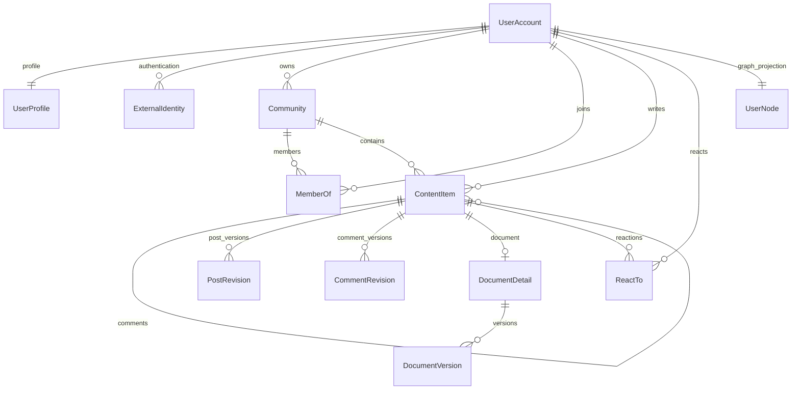

# Реляционная модель и компактный граф

## Основные таблицы SQL Server

| Таблица | Назначение и связи |
|---|---|
| auth.UserAccount | Учётная запись; PK UserID, уникальные Login и EmailNormalized |
| auth.UserProfile | Профиль 1:1 с UserAccount через PK/FK UserID |
| auth.ExternalIdentity | Привязка проверенного Firebase UID к UserAccount |
| social.Community | Сообщество; OwnerUserID → UserAccount |
| social.MemberOf | Членство M:N; UserID → UserAccount, CommunityID → Community; статус и роль |
| social.ContentItem | Общая запись поста, комментария или документа; FK автора и сообщества |
| social.PostRevision | Версии поста; ContentID → ContentItem, EditedByUserID → UserAccount |
| social.CommentRevision | Версии комментария; ContentID → ContentItem |
| social.DocumentDetail | Метаданные документа; PK/FK ContentID → ContentItem |
| social.DocumentVersion | Бинарные файлы или текст, контрольная сумма и версии; ContentID → DocumentDetail |
| social.ReactTo | Реакции M:N; составной PK (UserID, ContentID), два FK |
| ops.AuditEvent | Аудит действий с FK на пользователя |

См. исполняемые определения в [database](../database/README.md).
Комментарии используют ParentPostID и составной внешний ключ, который требует
родительский POST из того же сообщества. Авторство и принадлежность сообществу
больше не выражаются отдельными графовыми рёбрами.

## ER-диаграмма

## Только две графовые таблицы

- social.UserNode AS NODE: проекция пользователей; UserID одновременно PK и FK.
- social.Follows AS EDGE: направленная подписка между UserNode.

Edge constraint допускает только связь UserNode → UserNode; уникальный индекс
исключает повторную подписку. Самоподписка запрещена. Граф иллюстрирует обход
в два шага, а основная бизнес-модель и доступ к данным остаются реляционными.

## Целостность и доступ

- CHECK ограничивает статусы, роли, типы публикаций и реакций.
- Уникальные индексы допускают одну текущую версию материала.
- Операции публикации и изменения версий транзакционные.
- Проверка доступа учитывает статус аккаунта, сообщества, публикации и членства.
- Firebase ID token проверяется backend; переданный клиентом UserID не является
  доказательством личности.
- Файлы до 10 МиБ сохраняются в DocumentVersion вместе с SHA-256. Удаление
  RAG не означает удаление загруженных документов из существующей базы.

## Старые базы

Это новая учебная схема, не автоматическая миграция. Старую базу не сбрасывать.
Перед переносом отдельно проверяются соответствия графовых рёбер новым FK,
байты документов и их версии, роли и закрытые материалы. До такой миграции
исходная база и её резервная копия сохраняются.
