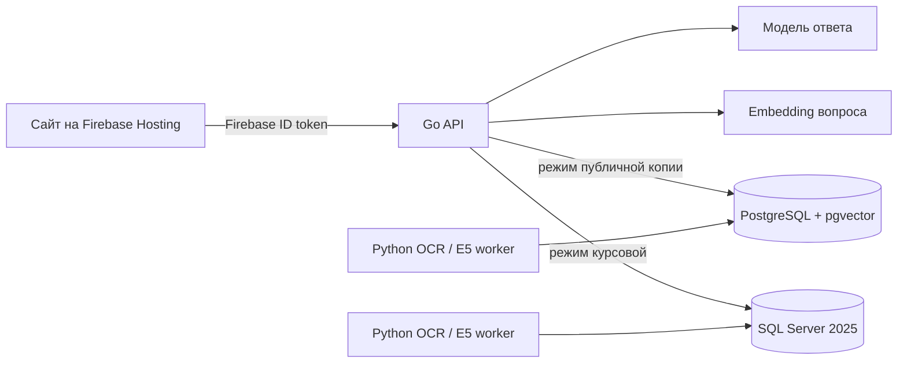

# Параллельная PostgreSQL-демонстрация

Курсовая работа описывает и предъявляет **SQL Server 2025, T-SQL и SQL Graph**.
PostgreSQL-скрипты в [`database/postgres/`](../database/postgres/) реализуют те
же пользовательские сценарии для публичного приложения на бесплатном хостинге.
Это два развёртывания одной предметной модели, а не перенос курсовой на другой
диалект. Данные между базами автоматически не синхронизируются.

| Возможность | Курсовая: SQL Server | Публичная копия: PostgreSQL |
| --- | --- | --- |
| Пользователи, сообщества, контент, права | T-SQL, схемы `auth` и `social` | Совместимые функции и таблицы с теми же ограничениями доступа |
| Социальный и предметный граф | SQL Graph `NODE`/`EDGE` | Таблицы узлов и рёбер с внешними ключами и источником свидетельства |
| Текстовый поиск | SQL Server Full-Text Search | PostgreSQL full-text search |
| Векторный поиск | `VECTOR(384)` и `VECTOR_DISTANCE` | `pgvector` `vector(384)` и косинусное расстояние |
| Индексация PDF/DOCX и русского OCR | Python worker и Tesseract | Тот же конвейер с отдельным адаптером к PostgreSQL |
| Ответы RAG и лента | T-SQL-процедуры с повторной проверкой доступа | PostgreSQL-функции с тем же HTTP-контрактом и проверкой источников |

Сайт на Firebase Hosting не хранит строку подключения к базе. Он получает
Firebase ID token и вызывает Go API по HTTPS. Backend проверяет токен и
выбирает движок только из серверного окружения: `SQLSERVER_DSN` для курсовой
или `POSTGRES_DSN`/`DATABASE_URL` для PostgreSQL. Обе базы хранят бинарные
оригиналы документов внутри БД; текст, фрагменты и связи привязаны к текущей
редакции. Права закрытых сообществ проверяются **до** использования фрагмента
и повторно перед выдачей ответа.



## Порядок запуска публичной копии

1. Создайте бесплатный проект PostgreSQL с поддержкой `pgvector`, например
   [Neon Free](https://neon.com/pricing), и сохраните строку подключения как
   секрет. Примените скрипты в порядке из
   [`database/postgres/README.md`](../database/postgres/README.md). Не
   направляйте PostgreSQL-миграции на базу курсовой.
2. Запустите Go API из [`backend/`](../backend/README.md) с
   `POSTGRES_DSN` или `DATABASE_URL`, `FIREBASE_PROJECT_ID` и
   `FIREBASE_WEB_API_KEY` из публичной конфигурации Firebase.
   Для [Vercel Go Runtime](https://vercel.com/docs/functions/runtimes/go)
   задайте корнем проекта `03SQL-CourseWork/backend`, preset `go` и секреты
   окружения. Из-за лимита тела запроса задайте `MAX_DOCUMENT_BYTES=4194304`
   (4 МиБ). Перед подключением сайта проверьте `/readyz` и защищённый
   маршрут с настоящим Firebase ID token.
3. Запускайте [`postgres_index_worker.py`](../worker/README.md#postgresql-демонстрация)
   по мере поступления заданий или по расписанию. Постоянный опрос раз в 10
   секунд может не дать бесплатной базе заснуть. Для RAG нужен доверенный
   OpenAI-совместимый endpoint LLM. Если постоянно доступного сервиса
   embeddings нет, миграция 08 и Go API используют полнотекстовый поиск и
   граф с тем же контролем доступа; семантического поиска по вектору вопроса
   в этом режиме нет. Без LLM `POST /api/v1/rag/queries` отвечает `503`.
   Адреса сервисов и ключи указывайте только в секретах backend.
4. Когда весь путь проверен, укажите HTTPS-адрес API в
   [`web/public/config.js`](../web/public/config.js), задайте
   `maxDocumentBytes: 4 * 1024 * 1024` и установите `backendReady: true`.
   До проверки оставляйте сайт в текущем честном
   состоянии. Локальный `POSTGRES_DSN` и учётные данные Firebase никогда не
   передавайте клиенту.

### Подключение с минимальными правами

Миграция `07-security.sql` создаёт роли `coursework_api` и
`coursework_worker` без права входа. Это намеренно: миграции можно применять
без паролей, а приложение не должно входить как владелец схемы. После
применения миграций администратор один раз разрешает вход этим ролям:

```sql
ALTER ROLE coursework_api WITH LOGIN;
ALTER ROLE coursework_worker WITH LOGIN;
```

В Neon Console на странице **Roles** для каждой роли используйте **Reset
password** и сохраните два разных случайных пароля в менеджере секретов.
Пароли не помещайте в SQL Editor, его историю, файлы репозитория, PR или чат.
Строку подключения Neon для роли `coursework_api` добавьте в Vercel как
защищённую переменную `DATABASE_URL` проекта API; для GitHub Actions задайте
**отдельную** строку роли `coursework_worker` в секрете
`COURSEWORK_POSTGRES_DSN`. Используйте соединение с проверкой TLS-сертификата.
Подключение Neon через Marketplace даёт Vercel длительный доступ к проекту;
перед его установкой проверьте проект, базу и выбранную роль. Для одной
строки подключения достаточно и ручной защищённой переменной Vercel.

После настройки проверьте, что оба логина работают и имеют только нужные
права: API вызывает пользовательские `usp_*` функции, worker — функции
очереди `ops`. Владелец базы не должен быть записан ни в одну переменную
окружения приложения.

### Обработка очереди через GitHub Actions

В публичном репозитории файл
[`coursework-postgres-index.yml`](../../.github/workflows/coursework-postgres-index.yml)
запускает индексатор раз в 30 минут и вручную. После слияния PR в основную
ветку задайте секрет репозитория `COURSEWORK_POSTGRES_DSN` для пользователя с
ролью `coursework_worker` и переменную репозитория
`COURSEWORK_POSTGRES_INDEX_ENABLED=true`. До этого задание отключено. Сначала
выполняется лёгкая проверка очереди `ops.has_pending_index_outbox()`; если
заданий нет, модель E5 и русский OCR не устанавливаются. При наличии заданий
процесс обрабатывает до 20 событий за запуск, а модель кешируется между
запусками. Не передавайте секреты в логи или файл workflow.

Расписание GitHub Actions может запускаться с задержкой; недавно опубликованный
материал останется в состоянии `PROCESSING`, пока worker не обработает его.
[Стандартные минуты Actions для публичных репозиториев бесплатны](https://docs.github.com/en/billing/concepts/product-billing/github-actions),
но этот механизм не даёт строгой гарантии времени индексации.

[Neon Free](https://neon.com/pricing) на октябрь 2026 года предоставляет
проект без карты и ограничения по дате, с лимитами на хранение и вычисления;
при исчерпании квоты или изменении условий публичный сервис может стать
недоступным. [Vercel Hobby](https://vercel.com/docs/plans/hobby) тоже ограничен
квотами. У Vercel Function есть [предел размера тела запроса](https://vercel.com/docs/functions/limitations),
поэтому для прямой загрузки через Vercel публичный сервер и клиент ограничены
4 МиБ. Если понадобятся документы до 10 МиБ, потребуется прямая загрузка в
хранилище с серверной проверкой прав. Локальная версия курсовой сохраняет
предел 10 МиБ.

Публичное развёртывание, учётные записи провайдеров и запуск миграций
проверяются отдельно; наличие файлов в репозитории само по себе не означает,
что рабочее приложение уже размещено.
